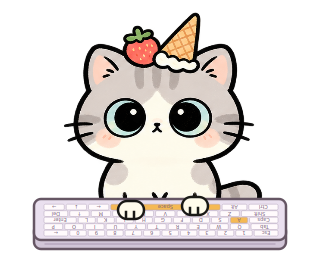

# -# 🍓 草莓冰淇淋桌面猫

给桌面养一只猫：陪你打字、追着小鱼干跑，也会因为被摸肚子而炸毛。

这是一个使用 **Python + PySide6** 制作的 Windows 桌面小程序。

## 🐱 猫咪会做什么

- 走路、跑动、跳起、扑向小鱼干。
- 闲置时舔爪、舔毛、抓地板、摇尾巴。
- 打字时拿出小键盘，对应实体按键亮起。
- 追上鱼干后吃掉它，鱼干稍后重新出现。
- 小手摸头会享受；摸肚子或屁股会炸毛、哈气。
- 可切换活动和睡觉模式，睡觉后只有主动切换才醒。
- 记住选择的模式，支持登录 Windows 后自动启动。

## 🚀 开始使用

需要 **Windows、Python 和 PySide6**，目前提供的是源码版本。

1. 下载整个项目并全部解压，保持文件夹结构。
2. 首次使用运行 `cat/install.bat` 安装依赖；已安装可跳过。
3. 双击最外层的 `start.vbs`，启动猫咪与玩具指针，不显示黑色命令窗口。

详细操作请查看 `先看这里.txt`。

## 🖐️ 互动方式

- **切换鱼干／小手**：右键任务栏右下角的玩具指针图标。
- **摸摸与挠痒**：小手模式下点击猫咪，或按住轻轻移动。
- **搬动猫咪**：鱼干模式直接拖动；小手模式用 Alt＋拖动。
- **活动／睡觉**：右键猫咪或任务栏猫图标选择模式。
- **找回猫咪**：右键任务栏猫图标，选择“叫回小猫”。

## ⏰ 自动启动与退出

- `enable_autostart.vbs`：开启当前账号登录后自动启动。
- `disable_autostart.vbs`：取消自动启动。
- 开启后请保持项目文件夹位置不变。
- 猫咪和玩具指针分别通过右键菜单退出。
- 玩具指针退出时恢复原鼠标样式；也可运行 `fish/restore_cursor.vbs` 手动恢复。

## 📝 使用说明

按键和鼠标位置仅用于即时互动，不保存输入文字或鼠标轨迹。猫咪与指针通过本机通信，不向互联网发送这些数据。

部分软件会使用自己的鼠标样式，可能覆盖玩具指针；多屏追逐目前主要适用于猫咪所在的屏幕。

项目在 AI 辅助下制作，欢迎交流玩法和改进建议。
